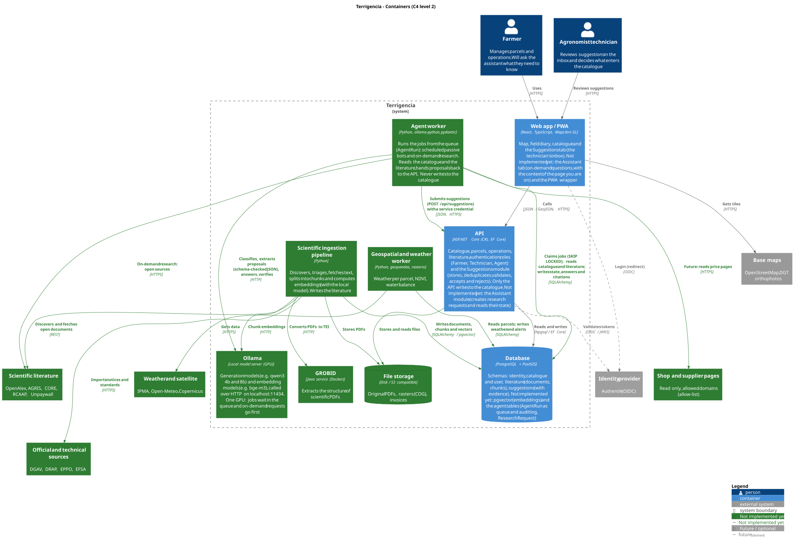

# Terrigencia

Land management for small farmers in northern Portugal, with an assistant that is meant to learn from scientific literature without ever being trusted blindly.

> **This is a showcase repository.** It holds architecture notes, the purpose of the project and the plans for the future. The source code lives in a private repository.

## The problem it solves

Good agricultural knowledge exists, but it sits in scientific papers, official notices and technical reports that are written for researchers, often in English, and hard to find. The farmers who would gain the most from it, the ones furthest from advanced agriculture, are the ones least able to reach it.

**Terrigencia is a way of bringing that literature to those farmers.** It reads the literature for them, turns it into practical catalogue entries (which procedure suits which crop, which product at which dose) with the original quote as proof, has a technician check each one, and shows the result in plain Portuguese next to their own parcels. The farmer does not need to read a paper; the paper is still one click away.

## Purpose

Small farms in the north of Portugal juggle many parcels, many crops and a lot of knowledge that is scattered across papers, official notices and product labels. Terrigencia puts that on one screen:

- **Parcels on a map.** Draw a parcel, give it a crop, see all your land at once.
- **Field diary.** Record what was done on which parcel and when.
- **A shared catalogue** of crops, procedures (pruning, harvest, sowing...) and resources (consumables and equipment), with the link between them: which procedure suits which crop, and which product at which dose.
- **A knowledge base of literature** and, on top of it, bots that *suggest* new catalogue entries with quotes as proof. A technician reviews every suggestion before it becomes real data.

It is also a personal project to practise building a complete product: a typed API, a map-heavy web app, a review workflow, and local language models.

## The idea that shapes the design

```
 literature ──▶ BOT ──▶ Suggestion (Pending) ──▶ HUMAN reviews ──▶ catalogue
 a question ──▶ BOT ─┘                           accept / reject
```

**A bot never writes to the catalogue.** It can only propose, through one API endpoint that checks the proposal with the same rules a person would face, demands a quote that really exists in a source, and refuses duplicates. A person accepts or rejects. Everything else in the architecture follows from this rule. Details in [Suggestions and the assistant](docs/suggestions-and-assistant.md).

## Status

| Area | State |
|---|---|
| Authentication, parcels on a map, field diary | Done |
| Catalogue: crops, procedures, resources | Done |
| Literature: documents and text chunks | Done (no embeddings yet) |
| Roles and the suggestions inbox (submit, accept, reject) | Done |
| Local models (Ollama), vector search, literature ingestion for one crop | Next |
| Passive bots that propose catalogue entries | Planned |
| On-demand assistant that answers with citations | Planned |
| Analytics on the farmer's own records (activity, input use, calendar, bot quality) | To be planned |
| Mobile (PWA first) | Planned |

The full plan is in the [roadmap](docs/roadmap.md).

## Tech at a glance

| Layer | Technology |
|---|---|
| Web | React 19, TypeScript, Vite, MapLibre GL; Portuguese UI, light and dark theme |
| API | ASP.NET Core 10, controllers and services, EF Core 10 |
| Database | PostgreSQL 16 with PostGIS |
| Workers | Python (uv) for ingestion and bots |
| Models | Local, through Ollama (embeddings and small language models) |
| Quality | xUnit with Testcontainers, Vitest, GitHub Actions |



## Read more

| Topic | Document |
|---|---|
| How the system is put together and why | [Architecture](docs/architecture.md) |
| What the data model contains | [Domain model](docs/domain.md) |
| Suggestions, bots, guardrails and the local models | [Suggestions and the assistant](docs/suggestions-and-assistant.md) |
| Literature pipeline and retrieval | [Literature and RAG](docs/rag.md) |
| What comes next | [Roadmap](docs/roadmap.md) |
| All diagrams, in one place | [docs/diagrams](docs/diagrams) |

## Design principles

1. **One source of truth.** A single database and a single API own the data and the rules.
2. **Humans decide.** Models explain and propose; they never decide, and never invent doses or products.
3. **Every claim has a source.** A suggestion carries quotes that are checked against the stored text.
4. **Start small.** One crop, a few hundred documents, measured quality, then widen.
5. **Replaceable seams.** Authentication and the language model sit behind interfaces, so each can be swapped by configuration.
6. **Local first.** Data and models stay on the owner's machine unless a switch says otherwise.
