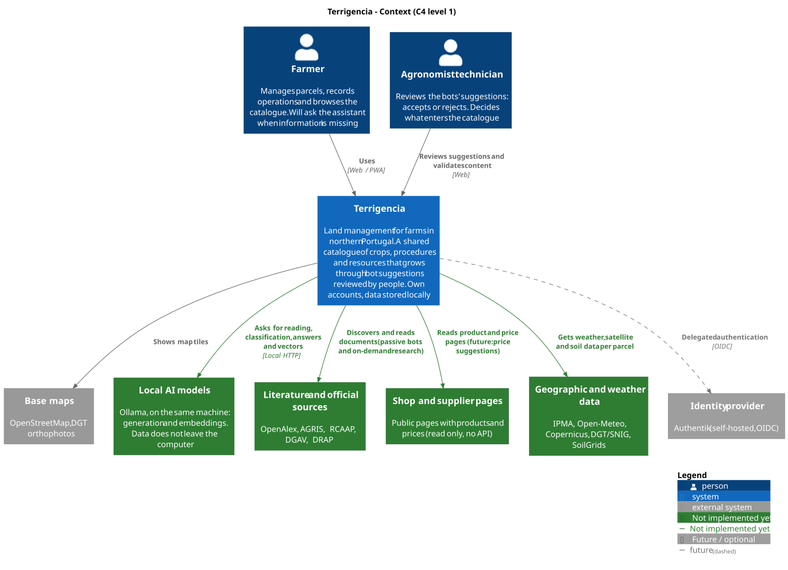
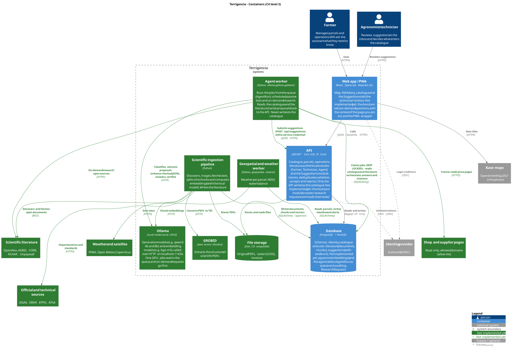

# Architecture

## Overview





```
React + MapLibre  ──JSON / GeoJSON──▶  .NET API  ──EF Core──▶  PostgreSQL + PostGIS
   draws parcels,                     auth, CRUD, rules,         (single source of truth,
   edits polygons                     owns the schema             schema = EF migrations)
                                                                        ▲
                                     Python workers ────────────────────┘
                                     ingestion and bots (write data, never the schema)
```

A **modular monolith**: one API, one database, no second backend. Workers in Python exist for the jobs where that ecosystem is clearly better (document parsing, model access), and they respect the same rules as everyone else.

## Backend

Layers, from the inside out:

| Layer | Holds |
|---|---|
| Core | Entities, value objects, DTOs, static mappers, service interfaces. No database code. |
| Infrastructure | The EF Core context and entity configurations, migrations, service implementations, everything specific to ASP.NET Identity. |
| Api | Thin controllers, error handling, creation of the domain user on first login. |

Choices worth noting:

- **DTO + mapper + service + controller** for every area. Entities never leave the services. Mapping is plain extension methods, with no mapping library.
- **Rules live in the domain.** A `Boundary` value object rejects empty, self-intersecting or out-of-range polygons, so an invalid parcel cannot exist. Rules that need the database stay in services.
- **Services return `null` for "not found" and throw for bad input.** One exception handler turns that into a 404 or a 400 with a readable message.
- **Ownership by construction.** Parcels belong to a user, diary entries belong to the owner of their parcel, and every query goes through that owner. Another user's data answers 404.
- **Shared catalogues** (crops, procedures, resources, documents) have names that are unique ignoring case, enforced by a check, a unique index and a catch for the database's unique violation.
- **Replace-a-list endpoints** (a procedure's crops, a document's chunks) are all-or-nothing transactions, which makes them safe to repeat.
- **Enums are stored as text**, and variable payloads as `jsonb`.
- **Geospatial maths** (area, "which parcel contains this point") is done by PostGIS, not in application code.

### Authentication, with an exit

ASP.NET Core Identity provides login and registration with cookies, so tokens stay out of browser storage. The application only knows an `ICurrentUser` interface (id, e-mail, roles). Moving to a self-hosted OpenID Connect provider later means writing one new implementation of that interface and deleting the Identity folder; the domain tables stay untouched.

### Roles from configuration

Roles are not stored in the database. A list of e-mail addresses per role in configuration decides who is a `Technician` (reviews suggestions) or an `Agent` (a bot account that may only submit suggestions). A claims transformation adds the role on each request. It is deliberately small: enough for one owner and a bot, easy to replace with an identity provider's groups.

## Frontend

React 19 with TypeScript, built with Vite, maps with MapLibre GL. The interface is in Portuguese.

- Organised **by feature**: each feature has its views, and separate plain functions for the API client, hooks and pure logic.
- A fixed pattern: **API client, then hook, then view.** Views only render what they are given. Logic that can be tested without a browser (reducers, formatters, season and dose helpers) is unit tested.
- "UI = f(state)": one state value, and the view derives from it. A hook that loads by id or filter ignores a slower answer for a value that is no longer current.
- Design tokens as CSS variables, with a dark theme through `prefers-color-scheme`.
- Pages that only a technician needs (the suggestions inbox) are hidden by role, and the API enforces the rule anyway.

## Workers

Python, managed with `uv`. Today an empty skeleton. Their rules are fixed in advance:

- They never change the database schema; migrations in the API project own it.
- They never write to the catalogue. A bot proposes through `POST /api/suggestions`, logged in as an `Agent`.
- Bulk literature data (documents, chunks, later vectors) may be written directly.
- Models run locally through Ollama behind an interface.
- Text from documents and web pages is untrusted data, never instructions.

## Quality

- **Tests:** unit tests for pure logic; API integration tests run against a real PostGIS database in a throwaway container (Testcontainers), so migrations, indexes and constraints are exercised for real. Frontend logic and render tests with Vitest.
- **Zero warnings:** the API builds with warnings as errors; the frontend lints clean.
- **CI:** GitHub Actions builds and tests each pull request.
- **Documented shortcuts:** every deliberate limit is marked in code with a `shortcut:` comment that says what the limit is and when to upgrade. Nothing is silently half-done.

## Decisions and their reasons

| Decision | Why |
|---|---|
| One backend, not a separate one for literature | Same data, same rules, one place to fix a bug. A second service would add a network hop and a second deployment for no gain at this size. |
| Python only for workers | The libraries for parsing and model access are better there; the API stays free of model code. |
| Repositories over EF Core? Not now | Services using EF Core directly are short and readable; a repository layer would add indirection without a second data source to justify it. Revisit if a service becomes hard to read. |
| JSON payload for suggestions | Five kinds share nearly all fields and differ in the payload. A column of JSON avoids a table and a migration per kind. |
| A table as the job queue | One database, one GPU, a handful of jobs. `SELECT ... FOR UPDATE SKIP LOCKED` hands each job to one worker; no broker to run. |
| Local models by default | Privacy, no per-token cost, works offline. The cost is weaker models, which is why the design checks them instead of trusting them. |
