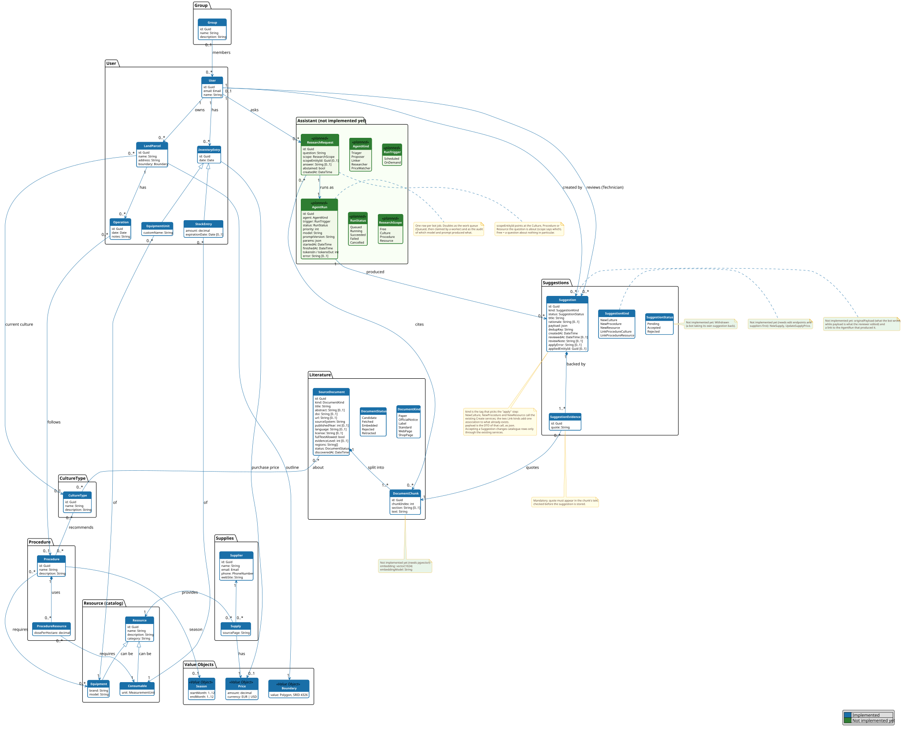

# Domain model

Blue is implemented; green is not implemented yet (the legend in the diagram says the same). It is the only domain diagram, and it is kept up to date as things get built.

## Private data: what a farmer owns

| Concept | Meaning |
|---|---|
| **User** | A person. Created automatically on first login from the authentication account. |
| **LandParcel** | A piece of land with a polygon boundary (WGS84), an optional address and at most one crop. Owned by one user. |
| **Operation** | A field-diary entry: a date, notes and, optionally, the procedure that was followed. Belongs to the owner of its parcel; deleting a parcel deletes its entries. |

Inventory (equipment units, stock entries) and suppliers with prices exist in the model but are not exposed yet.

## Shared catalogue: what everyone sees

The catalogue is shared on purpose: knowledge about "how to prune a vine" does not belong to one farmer.

| Concept | Meaning |
|---|---|
| **CultureType** | A crop. The catalogue starts with ten common northern crops (vine, maize, olive, chestnut, kiwi, potato, pasture, vegetables, apple and pear, dryland cereals). |
| **Procedure** | A task such as pruning or harvest: name, description, an optional season (start and end month, which may wrap the year end) and the crops it is recommended for. |
| **Resource** | Something a procedure uses, in two kinds stored in one table: a **Consumable** (fertiliser, pesticide, seed; has a unit) and an **Equipment** (tool or machine; has brand and model). |
| **Procedure ↔ Resource** | A procedure uses consumables with a dose per hectare, in the consumable's own unit, and equipment. |

Names are unique ignoring case. The resource catalogue starts empty and is filled as real ones are found.

## Knowledge: what the bots read

| Concept | Meaning |
|---|---|
| **SourceDocument** | A paper, official notice, label, standard, web page or shop page. Must have a DOI or a URL so every citation can be followed. Has a status along the pipeline (Candidate, Fetched, Embedded, Rejected, Retracted), a licence and the culture(s) it is about. |
| **DocumentChunk** | A paragraph-sized piece of a document, the unit that is cited (and later embedded). |

`SourceDocument` carries a legal switch, `fullTextAllowed`. When it is off, only the abstract may be stored as a chunk. This keeps the project on the right side of publishers' licences.

## Review: what sits between the two

| Concept | Meaning |
|---|---|
| **Suggestion** | A proposed catalogue change: a kind, a JSON payload that is exactly the input of the matching catalogue call, a status (Pending, Accepted, Rejected), and a normalized key that stops the same thing being proposed twice. |
| **SuggestionEvidence** | A quote from a document chunk. At least one is mandatory, and the quote must really appear in the chunk's text. |

How these fit together is explained in [Suggestions and the assistant](suggestions-and-assistant.md).

## Not implemented yet (green in the diagram)

- **Embeddings** are not on chunks yet, and the suggestion model still lacks the original bot payload, a "withdrawn" status and the link to the run that produced it.
- **AgentRun**: one row per bot job, which is both the work queue and the audit log (agent, model, prompt version, status, tokens).
- **ResearchRequest**: one row per on-demand question with its answer, the chunks it cited and whether it abstained.
- **Embedding model per chunk**: stored on each chunk, because changing the model means re-embedding everything.
