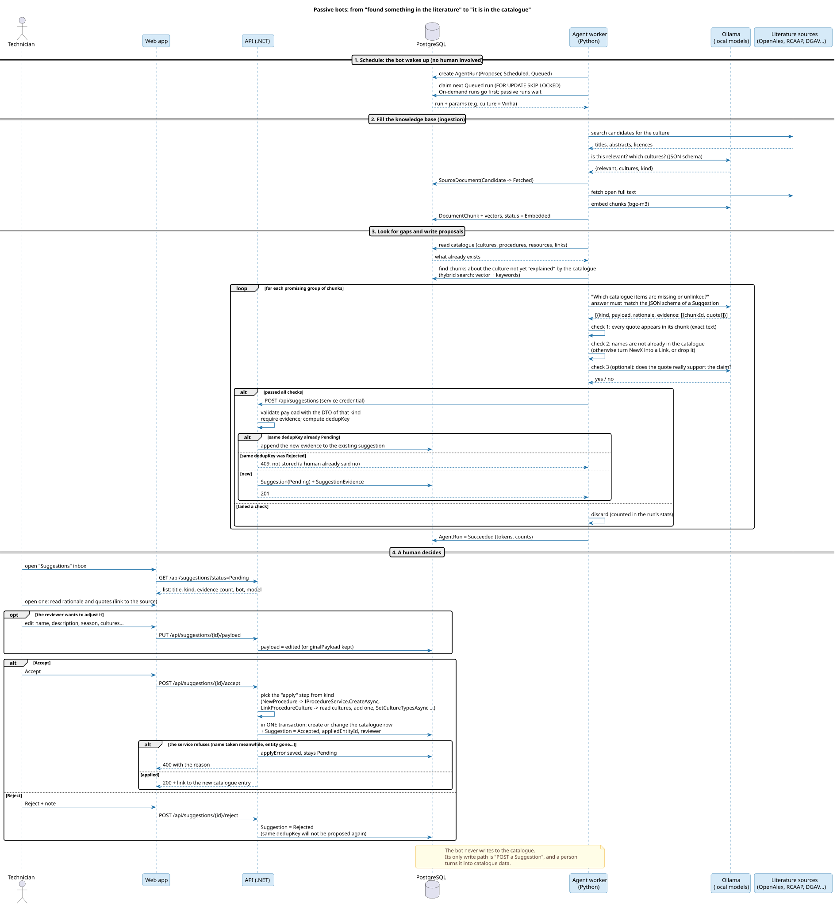
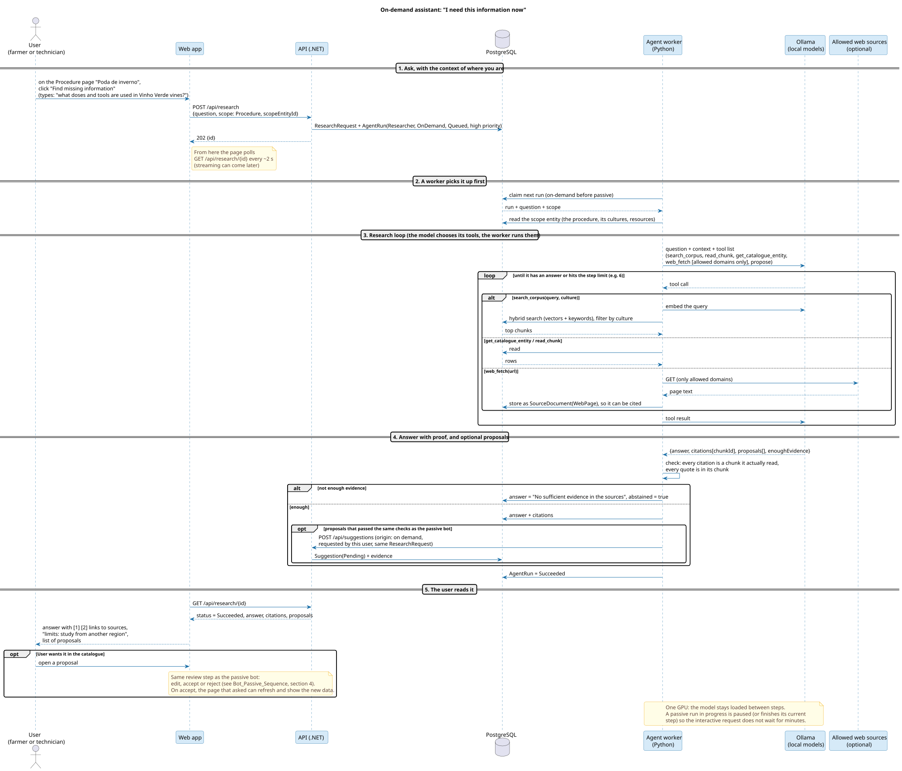

# Suggestions and the assistant

> Status: the review workflow (roles, suggestion tables and endpoints, the inbox page) is **implemented**. The bots, the queue and the on-demand assistant are **design**.

## One inbox, two doors

The catalogue is filled by people today. Bots should help fill it, **without ever being allowed to write to it**.

| | Passive bots | On-demand assistant |
|---|---|---|
| Trigger | A schedule, e.g. nightly | A person, from a page or the Assistant tab |
| Question | "What is missing from the catalogue?" | "I need to know X, now" |
| Scope | A whole crop or the whole corpus | One thing the user is looking at |
| Speed | Minutes to hours, nobody waits | Seconds to a minute |
| Output | Suggestions only | An answer with citations, plus optional suggestions |
| GPU priority | Low | High |

Everything else (database, queue, evidence rules, review screen, how a suggestion becomes catalogue data) is **shared**. One review path, two ways in.

The context and container diagrams are in the [architecture](architecture.md); green marks what is not implemented yet, which includes the whole assistant side.

## The suggestion

A suggestion has a **kind**, a **payload**, a **status** and mandatory **evidence**.

| Kind | Payload | Accepting it calls |
|---|---|---|
| `NewCulture` | the input of "create crop" | the crop service |
| `NewProcedure` | the input of "create procedure" | the procedure service |
| `NewResource` | the input of "create resource" | the resource service |
| `LinkProcedureCulture` | procedure id + crop id | adds one crop to the procedure's list |
| `LinkProcedureResource` | procedure id + resource id (+ dose) | adds one resource to the procedure's list |

The kind is a tag that routes the accepted proposal straight to the existing create function. The payload is **exactly the input of that function**, so accepting reuses every validation already written (duplicate names, season rules, doses above zero). A bot cannot create anything a person could not.

### Rules of the review path

- **Evidence is mandatory.** Each piece is a quote from a stored document chunk. The API checks that the quote appears in the chunk's text (ignoring case and spacing) before storing anything. A suggestion without proof is refused.
- **No duplicates.** A normalized key identifies *what* is proposed (a name lowered and stripped of accents, or a pair of ids). The same thing already pending gets the new evidence appended ("now supported by three papers"). The same thing already rejected is refused, so nobody is nagged twice.
- **Accepting can fail** if someone created the same name in the meantime. Then nothing changes, the reason is saved on the suggestion, and it stays pending.
- **No dependencies between suggestions.** If a bot finds a new crop *and* a procedure for it, it proposes the crop; once accepted, the next run sees both exist and proposes the link. Slower, much simpler.
- **Accept is one transaction** through the existing services.
- Cited chunks cannot be replaced afterwards, so evidence never silently changes under a suggestion.

### Roles

| Role | May |
|---|---|
| Farmer (any logged-in user) | Use their own parcels and diary |
| Technician | Review: list, read, accept, reject |
| Agent | Only `POST` suggestions (a service account for the bots) |

## Architecture of the bots

```
 React ──▶ .NET API ──▶ PostgreSQL ◀── Python agent worker ──▶ Ollama (local)
           (rules, roles,                (claims jobs,
            catalogue, review)            reads corpus, proposes)
                ▲                              │
                └── POST /api/suggestions ─────┘   (the only way a bot writes anything)
```

- **Agents live in Python**, where agent and structured-output libraries are. The API stays the owner of data and rules.
- **A bot writes through the API, not the database.** Rules live in one place, and a buggy bot cannot bypass them.
- **The queue is a table**, claimed with `SELECT ... FOR UPDATE SKIP LOCKED`. It doubles as the audit log: every suggestion points to the run that made it.
- **On-demand without streaming at first.** The question returns an id; the page polls for the answer.





### The bots

| Bot | Mode | Job |
|---|---|---|
| Triager | passive | Is this document relevant? To which crops? |
| Proposer | passive | Reads chunks, compares with the catalogue, writes suggestions with quotes |
| Linker | passive | Finds existing procedure + crop (or resource) pairs the literature supports but the catalogue does not link |
| Verifier | both | Checks that quotes exist; asks a model whether a quote supports its claim |
| Researcher | on demand | Answers with tools (search the corpus, read the catalogue) and citations, or abstains |
| Price watcher | later | Reads shop pages and proposes supplies and prices |
| Embedder | both | Turns text into vectors |

## Guardrails

1. A bot has **one write path**: the suggestions endpoint. No catalogue tool is ever handed to a model.
2. **No suggestion without evidence**, and each quote is checked against its chunk.
3. **Documents are untrusted text.** A paper or web page may say "ignore your instructions". The worker treats it as data, and the model's only output is schema-checked JSON.
4. **Doses and products need strong sources**: official notices, labels or papers with a known region. Otherwise the suggestion is flagged "weak evidence" or refused. The model never invents doses.
5. **Volume cap per run**, so the inbox does not drown.
6. **Web access only to an allow-list of domains**; a fetched page becomes a stored document so it can be cited and audited.
7. Every run records the model, the prompt version and the parameters.
8. A plain "I don't know" is a valid answer (abstention), and the assistant is expected to use it.

## Local models

Models run locally through [Ollama](https://ollama.com). Ollama can force an answer to match a JSON schema, which is what makes a payload trustworthy: the bot's output *is* the input of the catalogue call, or it fails to parse. It also provides tool calling and embeddings through the same server.

| Job | Candidate | Download size |
|---|---|---|
| Embeddings | `bge-m3` (multilingual, 1024 dimensions) | about 1.2 GB |
| Triage and verification | `qwen3:4b` | about 2.5 GB |
| Proposing and researching | `qwen3:8b` (tools and thinking) | about 5.2 GB |

The target machine has 8 GB of GPU memory, so **one model runs at a time** and the worker does one kind of job at a time, which is one more reason for a single queue. Sizes are from the model library pages at the time of writing; speed and "fits in 8 GB" are rules of thumb that still need measuring.

Small local models are weaker than hosted ones, especially in European Portuguese agronomy vocabulary and in saying "I don't know". That is why the design does not trust the model: exact-quote verification, schema-forced output, mandatory evidence and a human accept. A hosted model stays available as an off-by-default switch, because the worker talks to an interface and changing model is configuration.

## Open decisions

| Decision | Current direction |
|---|---|
| Bots write through the API or straight to the database? | Through the API |
| Embedding model and dimension (hard to change later) | `bge-m3`, 1024 dimensions, model stored per chunk |
| Web access for the on-demand bot | Own fetcher with a domain allow-list |
| Language of suggestions | Names and descriptions in Portuguese; quotes kept in their original language |
| Cloud model as fallback | Yes, as a switch, off by default |
| Rejected suggestions: block forever or allow on new evidence? | Block, with a "reopen" button |
